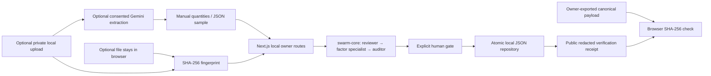

# TallyTrail

A local proof of concept for the IEEE ClimateChain **Carbon Markets & Emissions Transparency** track. Small businesses can enter energy evidence, inspect sourced Scope 1/2 calculations, review auditor findings, confirm a report, and share a reproducible SHA-256 receipt.

**Working locally:** structured bill import, optional original-file fingerprint/private local bill upload, deterministic swarm trace, full calculation provenance, human gate, overlapping-period protection, durable local records, public hash verification, browser recomputation of a shared payload, and duplicate offset registry/serial rejection. An optional Gemini vision/PDF extraction adapter is implemented and tested with handwritten offline provider fixtures; it has **not been live-verified**.

**Pending integrations:** live validation of optional extraction, Neon Auth, hosted Neon repository/private Blob storage, on-chain submission, registry proof. The included Anchor program has been **compiled and tested on an isolated local validator**, and remains undeployed to devnet/mainnet. App reports have no on-chain transaction signatures, and there are no real offset retirements. All live calls are disabled by default; no real provider request was made during development.

## Local setup

From the monorepo root:

```sh
npm install
cp apps/tallytrail/.env.example apps/tallytrail/.env.local
npm run dev --workspace @hackathon/tallytrail
```

Open <http://127.0.0.1:3101>. No environment variables or accounts are required for the local MVP. Owner routes reject hosted origins; authenticated hosting needs a separate implementation before publishing. Local JSON must not be used on ephemeral/serverless filesystems.

```sh
npm run typecheck --workspace @hackathon/tallytrail
node --import tsx apps/tallytrail/tests/domain.test.ts
node --import tsx apps/tallytrail/tests/extraction.test.ts
TSX_TSCONFIG_PATH=apps/tallytrail/tsconfig.json node --import tsx apps/tallytrail/tests/routes.test.ts
npm run build --workspace @hackathon/tallytrail
```

Use the direct `node --import tsx` test invocation: the tsx CLI creates an IPC socket that restricted environments may disallow. The app's Next config uses the supported TypeScript API and worker threads for restricted environments.

## One verified scenario

1. Click **Try a sample report**, or import `public/samples/bakery-bill.json`.
2. Analyze 2,400 kWh and 185 therms for the synthetic bakery in RFCE, September 2026.
3. Expect Scope 2 **652.26945679896 kg**, Scope 1 **982.61825 kg**, total **1,634.88770679896 kg CO₂e** before display rounding.
4. Review flags and select the explicit acknowledgement. Confirm locally.
5. Open the verification page; export the hash payload from report review, then select that JSON on the verification page for browser recomputation. Edit a quantity in the export to see a mismatch.
6. Analyze the same business and overlapping dates. Confirmation is blocked, including concurrent confirmations.
7. In Offset ledger, acknowledge and record a demo credit. Submit the same registry + serial again; it is rejected. Changing letter case or extra registry whitespace does not bypass the local key.

Use **New report** to start a blank manual form, or the sample button to restore synthetic data. Any supported energy source can be added back after removing a line. Draft review offers **Copy & correct fields** and **Discard draft**; confirmed reports remain immutable. Report dialogs support keyboard focus, Escape and focus restoration. JSON import uses the same browser-safe schema as the server, including date, unit and maximum-line checks. Historical anomaly checks use the latest reporting dates, even when reports were entered out of order. Reusing an original-file fingerprint produces an additional review flag.

No synthetic report exists in storage until you analyze it. The hero card and its bars are explicitly illustrative. Metrics come from saved reports, and gross emissions are never reduced by demo credit entries.

## Architecture and data



Stack: Next.js App Router, React, TypeScript, Zod, shared `@hackathon/swarm-core` and `@hackathon/ui`. Calculation/review agents are deterministic; the timeline records their actual execution metadata. Optional Gemini extraction is a separate consented step that populates editable fields before calculation. The sample/manual path makes no model calls.

`src/lib/store.ts` writes `.data/state.json` with mode 0600 under a mode-0700 directory. A cross-process mkdir lock serializes writes, and atomic rename commits them. Confirmation rechecks overlap while holding the lock. Bounded lock retries fail closed. If a process crashes while holding the lock, stop every app process, back up `.data`, and remove `.data/write.lock` before restarting. Records survive normal process restarts. The local business key is a normalized name, not an authenticated or legally verified identity. On-chain source uses signer keys instead.

| Record | Local contents | Optional Postgres table |
|---|---|---|
| Business | entered name in report input | `businesses` (owner, name) |
| Report | inputs, calculations, flags, hash, steps, confirmation | `reports` (business, period, JSON payload, hash, total) |
| Demo retirement | normalized registry/serial key, quantity, beneficiary | `offset_retirements` (unique registry + serial) |
| Run/step | actual deterministic trace saved on report | `agent_runs`, `agent_steps` (unique run + sequence) |

`src/db/*.ts.example`, `drizzle.config.ts.example`, and `drizzle/0000_optional_schema.sql` are optional integration designs, not activated or tested against a database. Install optional dependencies when network access is available:

```sh
npm install --workspace @hackathon/tallytrail drizzle-orm @neondatabase/serverless @neondatabase/auth @vercel/blob @solana/web3.js @coral-xyz/anchor
npm install --workspace @hackathon/tallytrail --save-dev drizzle-kit
```

To adopt Neon, copy the example files to `.ts`, configure pooled `DATABASE_URL` and unpooled `DATABASE_URL_UNPOOLED`, and integrate an authenticated repository. Generate/review a migration with `npx drizzle-kit generate`, then migrate a disposable Neon branch first. The optional schema uses one calendar month per business; the local app supports arbitrary date ranges. A production repository must add authenticated business IDs and transaction-safe overlap checks for arbitrary ranges. Do not treat this schema as a completed production integration. No database migration was executed here.

## Calculation provenance

Factors are pinned in `src/lib/factors.ts`; full-precision values are hashed, while the UI rounds only for display.

- [EPA 2025 Emission Factors Hub, Table 1 and AR5 GWPs](https://www.epa.gov/system/files/documents/2025-01/ghg-emission-factors-hub-2025.pdf): gas is `(53.06 + 1/1000×28 + 0.1/1000×265) × 0.1 = 5.31145 kg CO₂e/therm`. Stationary Distillate Fuel Oil No. 2 is `10.21 + 0.41/1000×28 + 0.08/1000×265 = 10.24268 kg CO₂e/gallon` using the published per-gallon columns. Vehicle fuel is deliberately unsupported.
- [EPA eGRID2023 Rev2 summary](https://www.epa.gov/egrid/summary-data): RFCE 599.170, CAMX 429.983, ERCT 736.629 lb CO₂e/MWh. Conversion is `×0.45359237÷1000` to kg/kWh. These are historical annual total-output factors. The app requires explicit region selection and does not infer region from ZIP.

This covers Scope 1 stationary combustion and Scope 2 location-based electricity. It excludes upstream emissions, other fuel types, market-based electricity claims and Scope 3. Factor years are visible; this is not real-time intensity. Confirm accounting suitability with a qualified reviewer before real reporting.

## Hash verification and security limits

The report hash is SHA-256 of recursively sorted-key JSON `{schema:'tallytrail.report.v1', input, calculation}`. The optional evidence-file SHA-256 is part of `input`. Fingerprint-only attachment keeps the file in the browser; optional private upload/extraction is documented below. Hash verification establishes consistency with a saved payload, not the truth of a utility bill. The public endpoint returns only report ID, period, totals, factor version, mode, timestamps and hashes. Business name, files, labels and quantities remain out of that response. Only confirmed reports are public.

Owner endpoints require a localhost URL; mutations reject a mismatching Origin and cross-site fetch metadata. JSON bodies have an actual 64-KB streamed limit; bill uploads have the separate bounded limit below. Input units/dates/numbers use strict Zod validation. This is a single-owner local demonstration, without user authentication or a distributed rate limiter. A person with filesystem access can alter local records; changing both a payload and its saved hash defeats local-only integrity. This is why the UI never claims independent attestation.

## Optional private bill upload and Gemini extraction

Expand **Private bill upload & optional extraction**. Select one PDF, JPEG, PNG or WebP up to **4 MiB** and consent to private local storage. Uploading without external-extraction consent makes no provider request. The default `.data/evidence` directory is outside `public`; files use random UUID names, mode 0600, and a mode-0700 directory. Declared MIME types are checked against file signatures. Filenames never determine paths. Files are served as downloads only through localhost-guarded routes; there is no public bill URL. Signature checks do not establish full document validity or malware safety. The private-file library reloads saved originals after refresh and supports deletion even when metadata is damaged or a file is incomplete. A 100-original guard keeps the local demo bounded; delete unneeded files before uploading more. Downloads recheck metadata, size, signature and hash.

For separately authorized live extraction, set `TALLYTRAIL_GEMINI_ENABLED=true` and `GEMINI_API_KEY` **server-side**, then restart. No client variable exposes the key. The UI then permits a separate per-file consent acknowledging that Google receives bill contents and API charges may apply. This is the only implemented provider activated by these settings. Other reserved environment variables do not activate pending integrations. There is no assumption about an account, key, quota or free allowance.

The server uses raw REST at fixed `https://generativelanguage.googleapis.com/v1beta/models/gemini-3.8-flash:generateContent`, documented `inlineData` for image/PDF bytes, and `generationConfig.responseFormat.text` for JSON schema. The endpoint cannot be user-overridden; redirects are rejected, timeout is 30 seconds, there are no retries, and responses are capped at 256 KiB. Source references: [official generateContent API](https://ai.google.dev/api/generate-content), [structured output](https://ai.google.dev/gemini-api/docs/generate-content/structured-output), [PDF inputs](https://ai.google.dev/gemini-api/docs/generate-content/document-processing), [image inputs](https://ai.google.dev/gemini-api/docs/generate-content/image-understanding), and [model catalog](https://ai.google.dev/gemini-api/docs/models).

The server accepts only complete `STOP` responses and validates extracted fields using the same strict `ReportInput` dates, positive finite quantities, unit combinations and period checks as manual entry. The user-selected RFCE/CAMX/ERCT region is retained; the model cannot infer ZIP mappings or emission factors. Missing/ambiguous evidence must fail rather than become a guessed bill. Returned fields load into the editable form for human review. Upload/extraction creates **no report**, never confirms, and never attests. If extraction fails, the just-uploaded local copy is deleted; successful copies remain until deleted through the UI or `DELETE /api/evidence/[id]`. Previously saved report fingerprints remain after deletion. Provider retention follows the provider/account terms; deleting a local copy does not delete provider-held data.

Endpoints: owner-only `GET /api/evidence` gives nonsecret configuration readiness and the private-file library; `POST /api/evidence` accepts multipart `file`, `region`, `storageConsent=true`, and optional `extractionConsent=true`. The actual streamed request is limited to 4 MiB + 64 KiB multipart overhead even without Content-Length. `GET /api/evidence/[id]` downloads the private original, and DELETE removes it. Storage under `public`/`.next` is explicitly rejected, including resolved symlink destinations. Local file copies are not encrypted at rest beyond operating-system permissions. Back up or delete them deliberately; hosted private Blob/auth integration remains pending. `DELETE /api/reports/[id]` discards drafts only and retains confirmed reports.

Tests use an explicitly injected transport and handwritten provider envelope, never a real key/request. The 22 targeted tests cover consent/config combinations, private persistence and deletion, damaged-file recovery, symlink privacy, MIME/header spoofing, excessive streamed bodies, external-origin rejection, invalid provider dates/units, truncation, failure cleanup, schema import validation, chronological usage history, reused evidence, immutable confirmed records, actual download/discard handlers, and no automatic report creation. This verifies wiring and safeguards, **not real-document extraction accuracy**.

## Anchor program status and next checks

`anchor/programs/tallytrail/src/lib.rs` defines `submit_report` with an `init` PDA seeded by `report`, business signer, and validated `YYYY-MM`; `retire_offset` uses `offset`, registry signer, and a 32-byte serial hash. No close/reinitialize instructions exist. The registry must sign its own namespace, preventing arbitrary callers from retiring on behalf of that registry. Registry-to-wallet identity and off-chain credit validity still need verified onboarding; a PDA alone does not establish them.

The current app is not wired to this program. Before any future adapter maps local date ranges to calendar-month PDAs, restrict accepted reports to whole calendar months and authenticated signer identities. Never silently drop date-range or identity information.

Rust/Cargo 1.99.1, Anchor CLI 0.32.1 and Solana CLI 2.3.0 are now installed under the monorepo’s ignored `.toolchains/`. Both Rust tests pass; the compiled SBF program and generated IDL passed both validator integration tests, including distinct duplicate transaction payloads rejected by account initialization. The program ID is a local test fixture, not a devnet/mainnet address. From the monorepo root, run `npm run build:contract` and `npm run test:contract`; `source scripts/native-env.sh` activates the native tools. SBF platform-tools v1.57 is required by the locked Rust 2024 dependencies, and the wrapper generates the IDL separately to keep its compiler flags correct. The following manual deployment steps remain owner-controlled:

```sh
cd apps/tallytrail/anchor
anchor keys sync
anchor build
cargo test -p tallytrail
anchor test
```

Generate the program keypair as required by Anchor before `anchor keys sync`; configure/fund only a local test wallet. The generated IDL supplies the client program address. Run validator tests on a fresh local ledger: they deliberately reuse a fixed demo period/serial. Review the source and validator results before any separately approved devnet deployment. No devnet/mainnet deployment was attempted.

## Submission checklist

- [x] Runnable local prototype, sample data, sourced factor provenance and architecture/schema docs.
- [x] Tests for calculation, unit/date validation, tampering, privacy, confirmation, overlap races, duplicate credits and request limits.
- [x] Compile the Anchor program and run Rust/local-validator tests.
- [ ] Review contract security and deploy to devnet with approval; connect an explicit transaction adapter.
- [ ] Live-verify the optional extraction adapter on authorized synthetic bills before advertising extraction accuracy; manual inputs remain the verified baseline.
- [ ] Implement authenticated hosted data/storage before publishing an external demo.
- [ ] Create approved public repository, retain MIT license, include actual tested integration state.
- [ ] Verify current Devpost eligibility/rules and prepare the requested 3–5-minute video and description.
- [ ] Owner approval for publication/submission; no account was created or submission sent.

License: MIT, inherited from the monorepo license.
